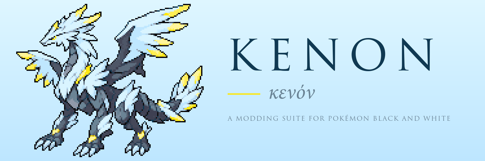

<h1></h1>

The modding suite for the native port of Pokémon Black and White.

## Download

Click your system to download. The builds are not signed: on Windows, choose
"More info" then "Run anyway"; on macOS, right-click the app and choose Open
the first time.

## Status

kenon opens the user's own ROM (`.nds`) and reads everything from it at run
time; it ships no game data. Edits are saved as a mod folder that
[eidos](https://github.com/Project-Holon/eidos) loads.

## Milestones

- [x] **Milestone 1**: App, ROM reading and mod folders
  - [x] Desktop app (Tauri + Svelte), dark and light themes
  - [x] ROM check, NitroFS, archives, compression
  - [x] Mod folders: changes saved as member overrides, list of changes with undo
- [x] **Milestone 2**: Graphics
  - [x] Sprites, palettes, screens and animations
  - [x] Pixel editor (also per animation frame)
  - [x] Pictures named from the ROM (Pokémon, items, trainers)
  - [x] Battle sprite, trainer and back sprite animations
  - [x] 3D textures (view only)
- [x] **Milestone 3**: Data and text
  - [x] Tables: Pokémon, moves, items, trainers and parties, wild encounters
  - [x] Wild encounters by Pokémon
  - [x] Text banks
  - [x] Trainer speech
- [x] **Milestone 4**: Map editor
  - [x] World map with every place
  - [x] 3D map view (lighting, time of day, seasons, camera preview)
  - [x] Tile kinds: paint, fill, select, move, copy
  - [x] People, trainers, signs, hidden items, warps and triggers
  - [x] What events say and do, editable
  - [x] Buildings and props: move, turn, add, remove
  - [x] Music and wild Pokémon per map
- [x] **Milestone 5**: Mod packages and code
  - [x] `.bw` package (zip, lossless)
  - [x] Hook and rule editors (Monaco), checked against eidos
  - [x] Mod settings, load order, conflict hints
- [ ] **Milestone 6**: Full map building
  - [ ] Copy map pieces between places
  - [ ] Paint the ground itself (new 3D map pieces)
  - [x] Water and other animated textures in the map view
  - [x] Items on maps (item balls, hidden items)
  - [ ] Add new item balls
- [ ] **Milestone 7**: Remaining editors
  - [ ] Sound editing
  - [ ] 3D texture editing
  - [x] Undo for deleted map events
- [ ] **Milestone 8**: Releases
  - [x] Release builds for Windows, Linux and macOS (CI)
  - [ ] App icons
  - [ ] First release

## Releases

Pushing a tag `vX.Y.Z` builds the app for Windows, Linux and macOS and
publishes the builds as a GitHub release. Set the version first with
`npm run set-version -- X.Y.Z` (it updates `Cargo.toml`, `package.json`
and `app/tauri.conf.json`), commit, then tag. The builds are not signed.

## Relationship to the other repositories

- [aletheia](https://github.com/Project-Holon/aletheia): the decompilation
  and the asset format knowledge kenon reuses.
- [eidos](https://github.com/Project-Holon/eidos): the engine kenon targets.

## License and legal

MIT (`LICENSE`). Kenon contains no game data and no reverse-engineered game
source; see `LEGAL.md`.
